<div align="center">



# Tensor Machine: Встраиваемый Сверхбыстрый Векторный Движок для Low-Latency Hybrid Search
### *Научно-технический обзор архитектуры, виртуальной машины и механизмов GPU-ускорения*

[](https://www.rust-lang.org/)
[](https://github.com/)
[](https://github.com/)
[](https://opensource.org/licenses/MIT)

</div>

---

<table>
<tr>
<td>

##  1. Аннотация и Введение (Abstract & Introduction)

### Аннотация
Современные архитектуры генерации ответов с дополнением знаниями (**Retrieval-Augmented Generation, RAG**) сталкиваются с барьером задержек (Latency) при передаче векторов и документов между процессами. Настоящий проект представляет **Tensor Machine** (Тензорная Машина) — высокопроизводительный распределенный RAG-движок на языке Rust, спроектированный как векторная реляционная СУБД с компилятором запросов и изолированной виртуальной машиной. Архитектура Tensor Machine разделяет фазы планирования и выполнения, оперируя структурами данных Apache Arrow и обеспечивая субмиллисекундные задержки на горячих путях инференса и поиска.

### Введение
Традиционные RAG-системы строятся путем склеивания разнородных компонентов (векторных баз данных, скриптов ранжирования и ML-сервисов инференса), что приводит к существенным накладным расходам на межпроцессное взаимодействие (IPC) и сериализацию данных. Tensor Machine реализует альтернативный подход **Hardware-Software Co-Design** («от железа вверх»):
1. **Colocated Execution:** Управляющий слой (Control Plane) и векторная VM могут работать в едином адресном пространстве или быть изолированы в отдельном процессе через высокоскоростные регионы общей памяти (`mmap`).
2. **Vector Relational VM:** Декларативный Lisp-подобный DSL транслируется компилятором в плоское промежуточное представление (IR байткод) и выполняется стековой VM над векторами Apache Arrow без копирования памяти.
3. **Графическое ускорение:** Алгоритм позднего взаимодействия ColBERT MaxSim полностью перенесен на GPU с использованием оптимизированного тайлового WGSL-шейдера и разделяемой памяти рабочих групп.

</td>
</tr>
</table>

---

<table>
<tr>
<td>

##  2. Трехуровневая архитектура (System Architecture)

Система организована в виде трех слоев, выполняющихся в рамках единого Rust-процесса (или изолированных процессов через IPC), что полностью устраняет накладные расходы на сетевой транспорт при локальной работе.

1. **Слой управления и транспорта (Control Plane & Transport):**
   - Сервер протокола MCP (Model Context Protocol).
   - Пулы подключений к реляционным базам данных (PostgreSQL) и векторным хранилищам (Qdrant).
   - Диспетчер виртуальной памяти (`mmap` Shared Memory Manager) для обмена данными с VM.
   - Оптимизация pushdown-предикатов (Predicate Pushdown).

2. **Декларативный DSL (Declarative DSL):**
   - Интерпретатор Lisp-подобных s-выражений на базе `lexpr`.
   - Компилятор запросов, преобразующий DSL в линейный байткод (IR bytecode).
   - Планировщик (Planner), строящий оптимальный граф выполнения.

3. **Тензорный движок выполнения (Tensor VM):**
   - Стековая виртуальная машина, поддерживающая 17 специализированных опкодов.
   - Прямая работа над массивами данных Apache Arrow.
   - Нулевое копирование при передаче результатов через FlatBuffers.

---

### Режимы выполнения VM
Tensor Machine поддерживает два режима интеграции вычислительного ядра:
- **In-Process Mode:** VM выполняется непосредственно в основном процессе MCP-сервера, минимизируя время отклика.
- **IPC Mode (`TENSOR_VM_MODE=ipc`):** VM запускается в изолированном рабочем процессе. Запросы и результаты передаются через проецируемые в память файлы (`mmap`), обеспечивая отказоустойчивость без потери производительности.

</td>
</tr>
</table>

---

<table>
<tr>
<td>

##  3. Аппаратная оптимизация и GPU-ускорение

Для расчета плотных векторов позднего взаимодействия по алгоритму **ColBERT MaxSim** используется специализированный вычислительный конвейер на GPU (через WebGPU API/wgpu).

### 3.1 Tiled WGSL Compute Shader
В отличие от наивной параллельной реализации, требующей постоянного обращения к глобальной памяти GPU, в Tensor Machine реализован тайловый шейдер с кооперативной загрузкой данных:
- Рабочая группа из 256 потоков обрабатывает одну пару (документ, токен запроса).
- Фрагменты векторов запросов и документов загружаются во временную память рабочей группы (`var<workgroup>`).
- Потоки выполняют вычисления локально, после чего производят редукцию для нахождения максимального сходства (MaxSim).
- Это снижает требования к пропускной способности памяти GPU в разы и устраняет бутылочное горлышко передачи данных.

### 3.2 Передача данных без выравнивания (Zero-Padding Offsets)
Традиционные GPU-вычисления требуют дополнения (padding) всех документов нулями до фиксированной максимальной длины токенов, что приводит к нецелевому расходу памяти и потоков (например, при сравнении документов длиной 5 и 250 токенов). 

Tensor Machine решает эту проблему через плоскую структуру данных:
- Все токены документов упаковываются в один сплошной плоский массив.
- Передается вспомогательный буфер смещений `(offsets)` с парами `(doc_start, doc_len)`.
- Шейдер считывает точное количество токенов для каждого документа, полностью исключая избыточные вычисления.

</td>
</tr>
</table>

---

<table>
<tr>
<td>

##  4. Сетевое масштабирование и Наблюдаемость

Для работы в высоконагруженных промышленных средах Tensor Machine оснащена встроенными механизмами масштабирования и мониторинга.

### 4.1 Arrow Flight Data Plane
Для распределенного обмена большими объемами векторных данных между узлами кластера используется протокол **Arrow Flight** поверх gRPC. Это позволяет передавать записи RecordBatch напрямую из памяти одного узла в память другого без сериализации.

### 4.2 Axum MCP Router & Sticky Sessions
Маршрутизация клиентских MCP-запросов осуществляется балансировщиком на базе Axum:
- Запросы распределяются по доступным воркерам.
- **Sticky Sessions:** Консистентное хеширование по ID сессии гарантирует, что запросы конкретного пользователя всегда попадают на один и тот же узел, сохраняя локальный кэш контекста в памяти воркера.

### 4.3 Метрики и Трассировка (Observability)
- **Prometheus метрики:** Сбор гистограмм задержки выполнения VM, счетчиков запросов и использования памяти, доступных через эндпоинт `/metrics`.
- **OpenTelemetry трассировка:** Инструментирование горячего цикла VM с помощью `tracing` Spans позволяет детально профилировать выполнение каждого опкода.
- **Structured JSON Logging:** Автоматический вывод логов в формате JSON для интеграции с ELK/Grafana Loki.
- **Health Checks:** Встроенные эндпоинты `/health` и `/ready` для оркестрации в Kubernetes.

</td>
</tr>
</table>

---

<table>
<tr>
<td>

##  5. Структура Репозитория

- **`tensor-rag/src/`** — Основное дерево исходного кода движка:
  - [`lib.rs`](./tensor-rag/src/lib.rs) — Точка входа в библиотеку, интеграционные тесты.
  - [`mcp.rs`](./tensor-rag/src/mcp.rs) — Сервер MCP, управление сессиями и инструментами.
  - [`ir.rs`](./tensor-rag/src/ir.rs) — Представление IR, компилятор-планировщик, опкоды VM.
  - [`vm.rs`](./tensor-rag/src/vm.rs) — Стек-ориентированная VM, выполнение инструкций.
  - [`dsl.rs`](./tensor-rag/src/dsl.rs) — Лексический разбор и валидация S-выражений.
  - [`arrow.rs`](./tensor-rag/src/arrow.rs) — Преобразование схем Apache Arrow и сборка RecordBatch.
  - [`db.rs`](./tensor-rag/src/db.rs) — Клиентские пулы Qdrant и PostgreSQL с мок-заглушками.
  - [`shared_memory.rs`](./tensor-rag/src/shared_memory.rs) — Управление разделяемой памятью через mmap-регионы.
  - [`gpu.rs`](./tensor-rag/src/gpu.rs) — Инициализация wgpu и шейдеров ColBERT.
  - [`flight.rs`](./tensor-rag/src/flight.rs) — Сетевой слой Arrow Flight для распределенного обмена данными.
  - [`router.rs`](./tensor-rag/src/router.rs) — Axum-маршрутизатор MCP-запросов со sticky sessions.
  - [`metrics.rs`](./tensor-rag/src/metrics.rs) — Метрики Prometheus и HTTP-эндпоинты здоровья.
  - [`result.fbs`](./tensor-rag/src/result.fbs) — FlatBuffers-схема сериализации результатов.

</td>
</tr>
</table>

---

<table>
<tr>
<td>

##  6. Сборка, Запуск и Конфигурация

### Требования к окружению:
- Установленный Rust-тулчейн (MSRV 1.75+)
- Компилятор C (для сборки библиотек-зависимостей)
- Совместимый графический ускоритель с поддержкой Vulkan/DirectX12/Metal (для GPU-режима)

### Сборка проекта (Release):
Соберите бинарные файлы с флагом оптимизации для достижения максимальной производительности:
```bash
cargo build --release
```

### Запуск тестов:
Прогоните полный пакет интеграционных и модульных тестов:
```bash
cargo test
```

### Бенчмаркинг производительности:
Для запуска тестов производительности GPU-шейдеров и масштабируемости под нагрузкой:
```bash
# Тестирование производительности алгоритма ColBERT (CPU vs GPU)
cargo bench --bench colbert

# Тестирование пропускной способности при высокой параллельной нагрузке
cargo bench --bench stress
```

### Переменные окружения (Конфигурация):
- `TENSOR_VM_MODE` — Режим запуска VM (`in_process` или `ipc`).
- `DATABASE_URL` — Строка подключения к PostgreSQL.
- `QDRANT_URL` — Адрес сервера Qdrant.
- `QDRANT_COLLECTION` — Имя целевой коллекции векторов.
- `MCP_BIND_ADDR` — Сетевой адрес для запуска MCP-сервера.
- `MAX_CONNECTIONS` — Максимальный размер пула сетевых соединений.

</td>
</tr>
</table>
